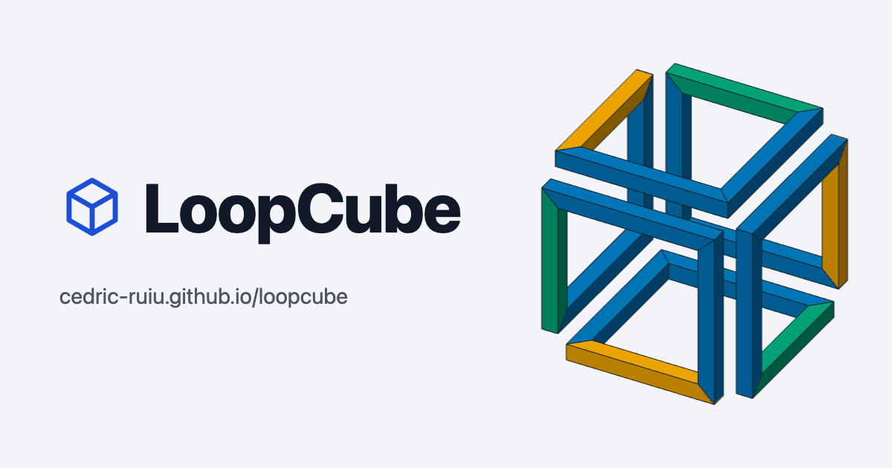

# LoopCube



LoopCube is a free, open source generator of **impossible cubes**, also called infinite cubes: a sculpture made of a single line of tube that closes on itself while tracing the edges of a cube. Set it up from the stock you have on hand, check it in 3D, and print a fabrication plan that is enough on its own to cut and weld its 18 parts. It is made for metal fabricators, pipe fitters, ironworkers and welders.

**[cedric-ruiu.github.io/loopcube](https://cedric-ruiu.github.io/loopcube/)**

## Features

- Three shapes: the classic cube, a framed cube (full-size top and bottom frames), and a box with its own length, depth and height, e.g. for a coffee table.
- Square tube with mitered corners, or round tube with weld elbows or bent sections.
- Standard stock sizes (EN 10219, NPS) or custom ones; cube edge, gap between bars, wall thickness, bend radius.
- Live 3D preview: rotate, zoom, diagonal view for the endless-line illusion, parts colored by type, part marks.
- Printable A4 fabrication plan: title block, dimensioned views, bill of materials and cut list.
- Millimeters or fractional inches; ISO first-angle or ASME third-angle drawings, following the language.
- French and English.

## Stack

- [Astro](https://astro.build/): static site, one pre-rendered page per language
- TypeScript
- [three.js](https://threejs.org/), loaded only when the 3D preview comes into view, rendered on demand
- [Umami](https://umami.is/): cookieless audience and usage events (see the [specification](docs/SPEC.md#9-audience-measurement))
- Vitest, Biome
- Node 24, Yarn 4 (Corepack)
- GitHub Pages, deployed by GitHub Actions

## Development

```sh
nvm use           # Node 24, from .nvmrc
corepack enable   # Yarn version from package.json
yarn install
yarn dev          # http://localhost:4321/loopcube/
yarn check        # astro check + Biome
yarn test         # Vitest
yarn format       # Biome, applies fixes
yarn build        # static site in dist/
yarn preview
```

## Architecture

```
src/
  geometry/  pure geometry: the loop, its parts, the cut list
  units/     units and dimension formatting
  catalog/   standard stock sizes
  viewer/    three.js scene
  plan/      printable plan, drawn in SVG
  app/       settings form, wiring between form, scene and plan
  i18n/      one file of strings per language
  pages/     language choice, one page per language, sitemap, robots.txt, 404
```

`geometry`, `units` and `catalog` are pure modules: no DOM, no three.js, no Astro (Biome rejects such imports). The geometry is the single source of truth for both the 3D scene and the plan, and is covered by unit tests.

## Branches

- Work happens on `develop`. Every push to `develop` and every pull request runs `yarn check` and the tests ([ci.yml](.github/workflows/ci.yml)).
- A pull request from `develop` to `main`, merged with a merge commit, deploys: check, tests and build, then `dist/` is published to GitHub Pages ([deploy.yml](.github/workflows/deploy.yml)). A failing check, test or build stops the deployment.
- Both workflows use Node from `.nvmrc` and Yarn through Corepack.

The [specification](docs/SPEC.md) describes what the app does and why: geometry, settings, fabrication, 3D view, plan, SEO and audience measurement.

## License

[MIT](LICENSE)
